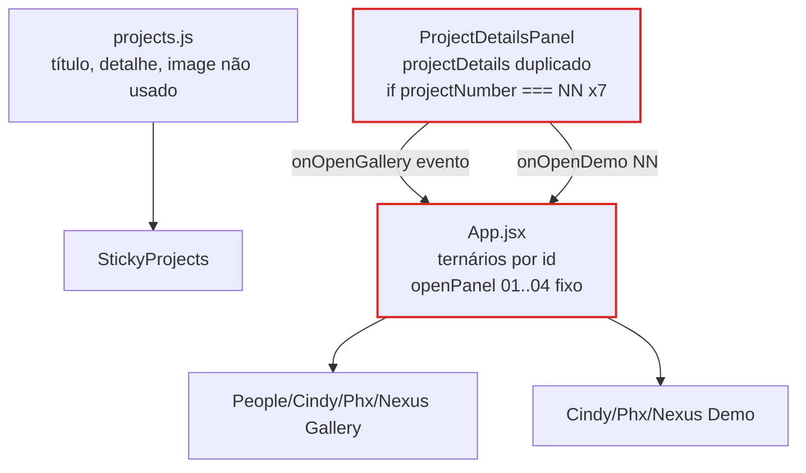
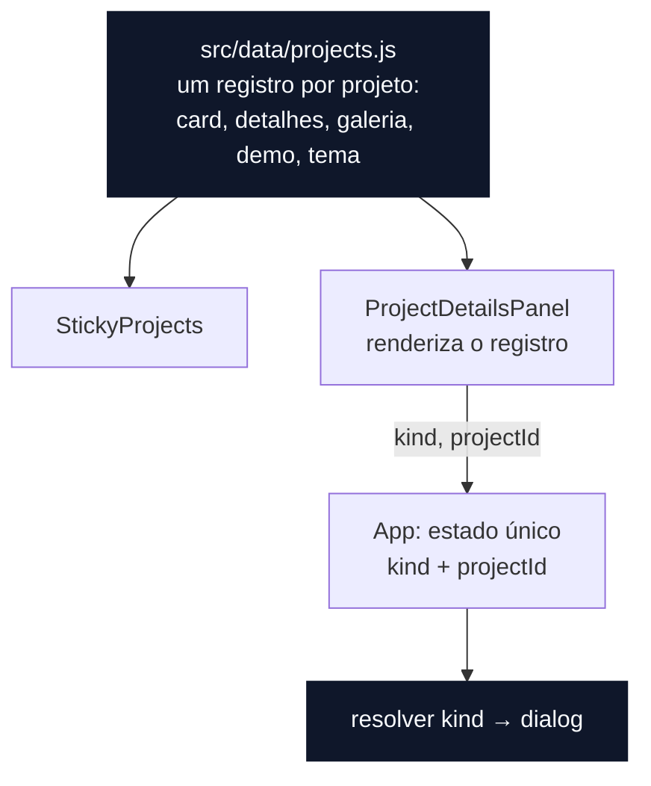
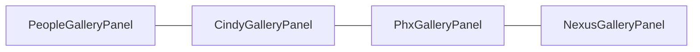
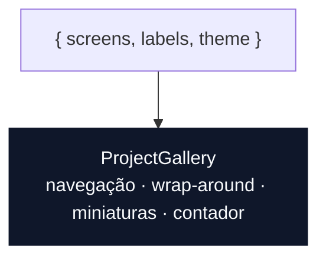
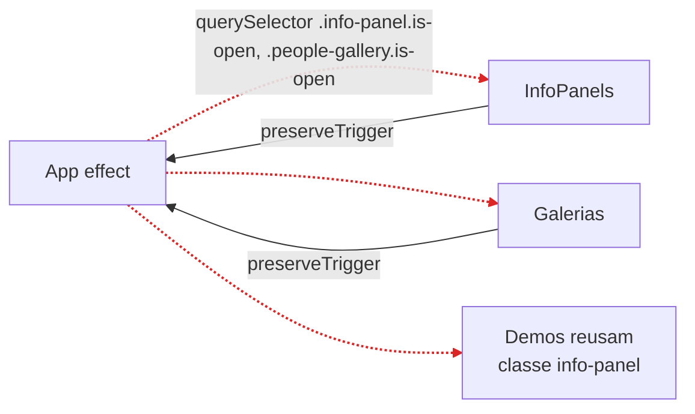
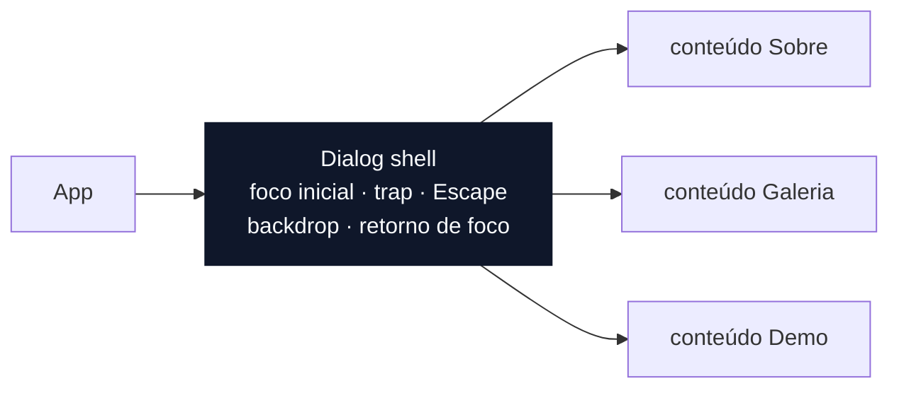
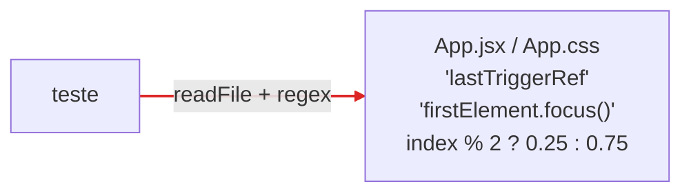
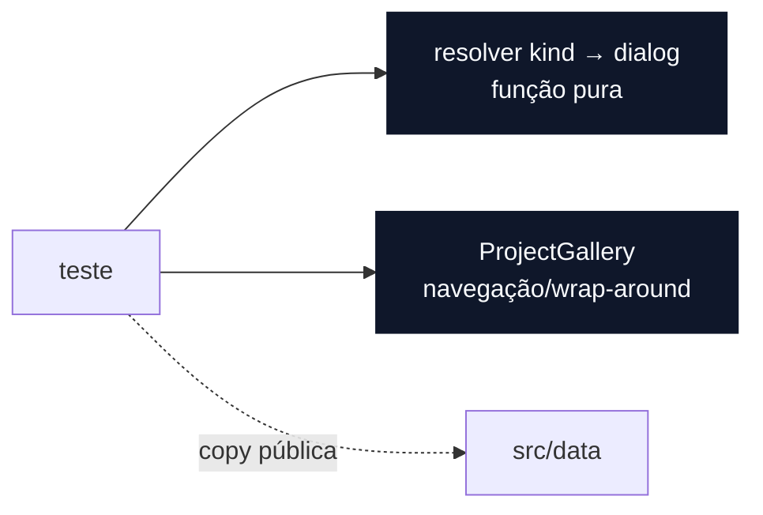

# Revisão arquitetural — 14/11/2026

> **Relatório histórico.** Este documento é a transcrição legível do relatório original [`2026-11-14-revisao-arquitetural.html`](2026-11-14-revisao-arquitetural.html), que foi gerado pela skill `improve-codebase-architecture` e está preservado sem alterações. O HTML depende de Tailwind e Mermaid via CDN; esta versão reproduz o conteúdo e os diagramas em Markdown/Mermaid.
> **Nota sobre os diagramas:** dois diagramas Mermaid do HTML original (candidato 3 "Antes" e candidato 5 "Antes") não renderizam, por erro de sintaxe nos rótulos. O HTML foi preservado sem alterações. Nesta transcrição, só esses dois rótulos foram colocados entre aspas, sem mudar o conteúdo, e os diagramas foram validados com o Mermaid 11.4.1.
> Os caminhos e números abaixo representam o snapshot `feat/adaptive-video-performance` @ `7f53175`. As decisões tomadas a partir deste relatório estão em [`2026-11-14-decisoes-arquiteturais.md`](2026-11-14-decisoes-arquiteturais.md) e nas [specs](../specs/README.md).

## Vocabulário

O relatório usa o vocabulário de design de módulos da skill `codebase-design`:

- **Módulo:** qualquer coisa com interface e implementação.
- **Interface:** tudo o que um chamador precisa saber para usar o módulo.
- **Profundidade:** comportamento disponível por unidade de interface. Um módulo é *deep* quando há muito comportamento atrás de uma interface pequena, e *shallow* quando a interface é quase tão grande quanto a implementação.
- **Seam:** o lugar onde a interface do módulo vive.
- **Leverage:** o ganho para os chamadores.
- **Locality:** o ganho para os mantenedores. Mudanças e bugs se concentram num lugar só.
- **Teste de deleção:** apagar o módulo concentra complexidade (o módulo se justifica) ou só a espalha (era pass-through)?

## Escopo e hot spots

Hot spots no histórico recente (últimos 60 commits): `src/App.css` (28 alterações), `src/App.jsx` (26), `README.md` (9), `src/sections/StickyProjects.jsx` e `src/components/panels/`.

## Validação executada

| Comando | Resultado |
|---|---|
| `npm test` | 24/24 ✔ |
| `npm run lint` | 0 avisos ✔ |
| `npm run build` | ✔ em 836 ms; JS principal 473 kB (147 kB gzip) |
| `git diff --check` | ✔ |
| Smoke em navegador e `perf:audit` | Não executados nesta revisão |

**Defeito latente confirmado:** em `ProjectDetailsPanel.jsx:145`, o código usa `onClick={onOpenGallery}`, então o argumento `gallery` recebe o evento de clique em vez do id. A galeria People só abre porque é o fallback do ternário em `App.jsx:328`. Além disso, o demo cai em `'nexus-demo'` para qualquer id desconhecido.

## Candidatos

### 1. Um registro de projeto e um resolver de dialog — `Strong` · in-process

**Arquivos:** `src/App.jsx:319-389`, `src/components/panels/ProjectDetailsPanel.jsx:21-232`, `src/data/projects.js`.

**Antes**

**Depois**

- **Problema:** adicionar um projeto exige editar o App (imports, ternários, bloco `activePanel ===`), o ProjectDetailsPanel (blocos `projectNumber === 'NN'`) e `projects.js`. Título e detalhe existem em duas cópias.
- **Solução:** mover `projectDetails` para `src/data/` (alinhado à ADR 0001), fundi-lo com `projects.js` e trocar os ternários por um resolver indexado por `{kind, projectId}`.
- **Ganhos:**
  - locality: novo projeto toca um arquivo de dados;
  - a interface do App encolhe para `{kind, projectId}`;
  - fallbacks silenciosos viram erro explícito;
  - dados de cópia param de duplicar;
  - o resolver fica testável como função pura.

### 2. Colapsar as quatro galerias num módulo de galeria — `Strong` · in-process

**Arquivos:** `src/components/panels/{People,Cindy,Phx,Nexus}GalleryPanel.jsx` (105–130 linhas cada) e `src/components/panels/{Cindy,Phx,Nexus}GalleryPanel.css` (7 regras; só as cores mudam).

**Antes:** quatro módulos shallow, com interface ≈ implementação. O mesmo estado, o índice circular, a topbar, as setas, o contador e as miniaturas estão copiados quatro vezes.

**Depois:** um módulo deep com interface `{ screens, labels, theme }`, que esconde navegação, wrap-around, miniaturas e contador. A variação vira dados mais um modificador de tema no CSS.

- **Problema:** pelo teste de deleção, apagar qualquer uma das galerias perde só dados; cada uma é shallow, e um bug de navegação precisaria ser corrigido quatro vezes.
- **Solução:** um módulo de galeria que recebe telas, rótulos e tema; as telas vão para o registro do candidato 1.
- **Ganhos:**
  - leverage: uma implementação para quatro projetos;
  - locality: um bug de navegação corrigido uma vez;
  - cerca de 350 linhas de JSX duplicadas a menos;
  - três arquivos CSS viram variáveis de tema.

### 3. Explicitar o seam de dialog — `Worth exploring` · in-process

**Arquivos:** `src/App.jsx:69-151` (focus trap, `Escape`, scroll lock e retorno de foco), `src/utils/focus.js` (5 linhas, um chamador) e cerca de 10 dialogs em `src/components/panels/`.

**Antes**

**Depois**

- **Problema:** o comportamento está centralizado (bom), mas o contrato que cada dialog precisa cumprir é implícito e repetido: classe raiz, `is-open`, `role`, `aria-modal`, `data-dialog-initial-focus`.
- **Solução:** um dialog shell dono do contrato; os dialogs fornecem só conteúdo. Respeitar a regra de imports diretos dos dialogs pequenos (sem lazy).
- **Ganhos:** contrato de acessibilidade num lugar só; dialogs sem classes-sinal; `focus.js` absorvido pelo shell.

### 4. Um módulo de demo em iframe (Nexus fica à parte) — `Worth exploring` · in-process

**Arquivos:** `CindyDemoPanel.jsx/.css` e `PhxDemoPanel.jsx/.css` (103 linhas de CSS cada, cerca de 8 cores diferentes). `NexusDemoPanel.jsx` (474 linhas) já é deep e deve ser mantido.

**Antes (corte transversal)**

| Camada | Conteúdo |
|---|---|
| Cindy | aside · topbar · voltar · nova aba · iframe |
| Phx | aside · topbar · voltar · nova aba · iframe |
| CSS | `CindyDemoPanel.css` ≈ `PhxDemoPanel.css` |
| Nexus (deep) | execução temporizada, abas, seções |

**Depois:** `IframeDemo { src, title, label, theme }` para Cindy e Phx; Nexus inalterado.

- **Problema:** os dois dialogs de demo em iframe são cópias; só mudam `src`, título, rótulo e cores.
- **Solução:** um módulo de demo em iframe configurado pelo registro do projeto.
- **Ganhos:** apaga um par JSX/CSS inteiro; uma terceira demo em iframe passa a custar só dados.

### 5. Testar pela interface, não pelo texto-fonte — `Worth exploring` · local-substitutable

**Arquivo:** `tests/unit/portfolio-contract.test.mjs` (344 linhas, 24 testes).

**Antes**

**Depois**

- **Problema:** os 24 testes passam, mas são `assert.match` sobre o código-fonte. Quebram em refactor e não pegaram o defeito do candidato 1. Foco, `Tab` e `Escape` não são exercitados em runtime, embora o `AGENTS.md` descreva essa cobertura.
- **Solução:** depois dos candidatos 1 e 2, testar o resolver e a navegação da galeria como lógica pura, sem dependência nova; avaliar depois um DOM em teste para o focus trap.
- **Ganhos:** a interface vira a superfície de teste; refactors deixam de quebrar testes; regressões reais passam a falhar.

### 6. Devolver estilos aos seus módulos e apagar o que está morto — `Speculative` · in-process

**Arquivos:** `src/App.css` (1498 linhas) e `src/assets/hero.png`, `react.svg`, `vite.svg` (sem importador).

**Antes — seletores em `App.css` por área**

| Área | Seletores | Observação |
|---|---:|---|
| hero | 44 | |
| project-stack-card | 35 | sem consumidor JSX |
| info-panel | 23 | estilo de dialog fora do dialog |
| contact-link | 19 | estilo de dialog fora do dialog |
| menu-link | 14 | |
| project-gallery-preview | 11 | estilo de dialog fora do dialog |
| sticky-projects | 6 | sem consumidor JSX |

**Depois:** `App.css` só com shell, hero e header; `InfoPanels.css` e `ProjectDetailsPanel.css` próprios; o deck legado apagado.

- **Problema:** cerca de 74 seletores de dialogs vivem em `App.css`, e o deck `.project-stack-card`/`.sticky-projects__*` (36 ocorrências) não tem consumidor. Um teste ainda aplica regex sobre regras de dialog em `App.css`.
- **Solução:** mover os estilos de dialog para o CSS do próprio dialog e remover CSS e assets mortos. Requer smoke visual, porque o risco é de cascata.
- **Ganhos:** locality, com o estilo junto do módulo; bundle CSS principal menor.

## Recomendação principal do relatório

**Candidato 1.** É o hot spot do histórico, já esconde um defeito latente (o evento passado como id de galeria) e é a fundação que torna os candidatos 2, 4 e 5 baratos: galerias e demos passam a ser dados do registro, e o resolver vira a primeira interface testável de verdade.

## Destino de cada candidato

| Candidato | Destino |
|---|---|
| 1 — Registro de projetos e navegação | [Spec 0001](../specs/0001-registro-projetos-dialogs-galeria.md). O "resolver genérico" foi substituído por um módulo puro de navegação mais um mapa explícito de demos |
| 2 — Galeria única | [Spec 0001](../specs/0001-registro-projetos-dialogs-galeria.md), mantendo as classes CSS atuais e reunindo os temas sem reescrever regras |
| 3 — Seam de dialog | Adiado ([índice das specs](../specs/README.md#adiados-fora-destas-specs)) |
| 4 — Demo em iframe única | Adiado; a Nexus permanece independente |
| 5 — Testes pela interface | [Spec 0001](../specs/0001-registro-projetos-dialogs-galeria.md), em três camadas, sem dependência nova |
| 6 — CSS e código morto | Assets do template e campos `image`/`alt` mortos na [Spec 0001](../specs/0001-registro-projetos-dialogs-galeria.md); CSS adiado para uma etapa independente |
